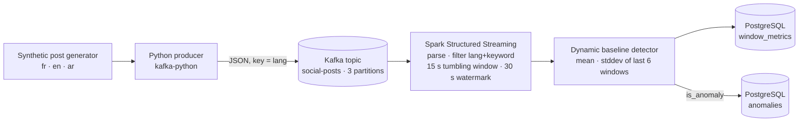

<div align="center">

# ⚡ Streaming Social-Event Anomaly Detection

**Kafka → Spark Structured Streaming → PostgreSQL: detect a sudden spike of French posts about a topic, while ignoring noise from other languages.**


</div>

---

## 📌 Overview

A reproducible, fully containerised **streaming data pipeline**. A Python producer simulates a multilingual (French / English / Arabic) social-media feed and publishes it to Kafka. A Spark Structured Streaming job counts posts per tumbling window, compares each count with a **dynamic baseline**, and persists every window plus detected anomalies in PostgreSQL.

The default scenario tracks the keyword **`manifestation`** in **French** posts. After a normal-traffic phase the producer injects a controlled French spike (and a decoy spike in English) — the job must flag the first and ignore the second.

> The data is **synthetic**; no real social-network data is used. The project was built for a streaming-analytics assignment (method notes in French: [`docs/rapport_methode.md`](./docs/rapport_methode.md), full report: [`rapport_projet_social_events.pdf`](./rapport_projet_social_events.pdf)).

## 🧭 Architecture



| Component | Container | Notes |
|---|---|---|
| Producer | `python:3.11-slim` | Normal traffic, then a spike at +75 s lasting 15 s (×6 multiplier) and an English noise spike |
| Broker | `apache/kafka:3.9.2` | KRaft mode, topic `social-posts` |
| Stream job | `python:3.11-slim` + PySpark 4.0.1 | Spark runs in local mode inside the container |
| Storage | `postgres:16` | Schema in [`db/init.sql`](./db/init.sql) |

## 🧠 Detection Method

For each `(keyword, language)` pair and each 15-second window, the job counts matching posts. The window is anomalous when

```text
count ≥ max( mean + 3·stddev ,  2·mean ,  10 )
```

where `mean` / `stddev` are computed over the **6 previous windows**. No anomaly can be raised until **4 windows of history** exist (cold-start guard), and the floor of 10 avoids alerts on low-volume noise.

| Parameter | Default | Env variable |
|---|---|---|
| Target keyword | `manifestation` | `TARGET_KEYWORD` |
| Language filter | `fr` | `FILTER_LANGUAGE` |
| Window / watermark | 15 s / 30 s | `WINDOW_DURATION_SECONDS`, `WATERMARK_SECONDS` |
| Baseline length | 6 windows | `BASELINE_WINDOWS` |
| Base rate | 4 posts/s | `POSTS_PER_SECOND` |
| Spike start / length / factor | 75 s / 15 s / ×6 | `SPIKE_START_AFTER_SECONDS`, `SPIKE_DURATION_SECONDS`, `SPIKE_MULTIPLIER` |

The streaming query uses a 5-second micro-batch trigger and stops after the first persisted anomaly (or the configured timeout).

## 🗄️ Data Model

| Table | Content |
|---|---|
| `window_metrics` | Every processed window: counts, baseline mean/stddev, threshold, `is_anomaly`, reason |
| `anomalies` | Only the windows flagged as anomalous |

## 🚀 Run

```bash
docker compose up -d
docker compose logs -f producer spark     # follow the pipeline
./scripts/check_results.sh                # inspect PostgreSQL results
docker compose down -v                    # clean up
```

Expected outcome (from the design, see `scripts/check_results.sh`): at least one row in `window_metrics` and one in `anomalies`, with `keyword = manifestation` and `lang = fr`.

### ✅ Tests

```bash
python -m unittest discover -s tests -v
```

Two unit tests cover the detector (spike flagged only after enough history) and the generator (spike batches contain French keyword hits). They pass on Python 3.10.

## 🗂️ Structure

```text
├── producer/      generator.py, run.py        # synthetic feed → Kafka
├── spark_app/     detection.py, job.py        # detector + streaming job
├── db/init.sql                                # PostgreSQL schema
├── data/config.json                           # languages & phrase templates
├── scripts/check_results.sh
├── tests/test_detection.py
├── docs/rapport_methode.md                    # method notes (FR)
└── docker-compose.yml
```

## ✅ Verified Run

The full Docker Compose stack was executed from a clean checkout. Observed `window_metrics` (keyword `manifestation`, language `fr`):

| Window start | Count | Baseline mean | Threshold | Anomaly |
|---|---:|---:|---:|:--:|
| 11:31:15 | 2 | – | 10.00 | no |
| 11:31:30 | 4 | 2.00 | 10.00 | no |
| 11:31:45 | 8 | 3.00 | 10.00 | no |
| 11:32:00 | 7 | 4.67 | 10.00 | no |
| **11:32:15** | **47** | 5.25 | **12.40** | **yes** |
| 11:32:30 | 35 | 13.60 | 64.11 | no |

The producer published 504 messages; one row was written to `anomalies` and the job stopped itself. Notes from the run: (1) the first start is slow because the Spark container installs a JRE and builds `pyspark` (several minutes) — the job still reads the whole topic thanks to `startingOffsets=earliest`; (2) a `StackOverflowError` was logged by Spark's stream-execution thread while the query was being stopped after the first anomaly — the results had already been persisted. Unit tests (`python -m unittest discover -s tests -v`): 2 / 2 pass.

## 🎓 What This Project Demonstrates

- Real-time ingestion with Kafka and event-time processing (windows + watermarks) in Spark Structured Streaming.
- A transparent, dynamic-baseline anomaly detector with a unit-tested core.
- Persisting streaming results in PostgreSQL and a one-command reproducible environment with Docker Compose.

## 🔭 Limitations & Future Work

- Synthetic, single-keyword scenario; the detector is a simple statistical baseline, not a learned model.
- Spark runs in local mode in one container; scaling out needs a real cluster.
- No dead-letter handling or exactly-once guarantees for the PostgreSQL sink beyond upserts on `window_metrics`.
- Future: multiple keywords, language-ID instead of a language field, seasonal baselines, alerting, and a dashboard.

## 👤 Author

**Nour Ghribi** · [GitHub](https://github.com/Nour-Ghribi)
